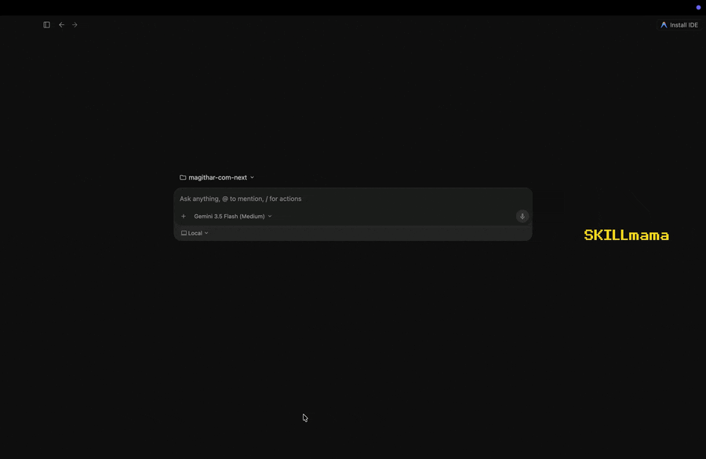
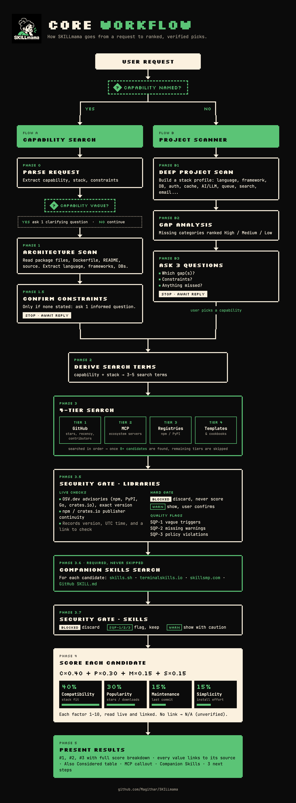
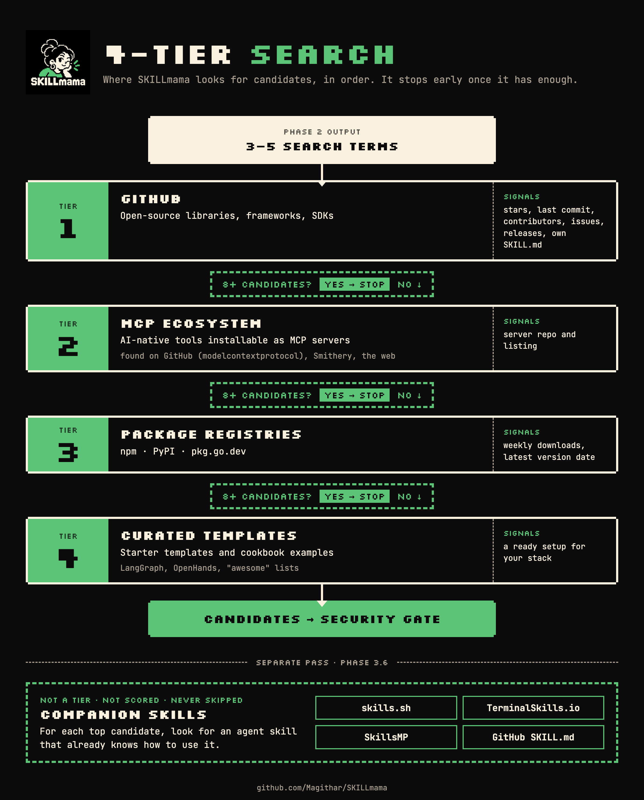
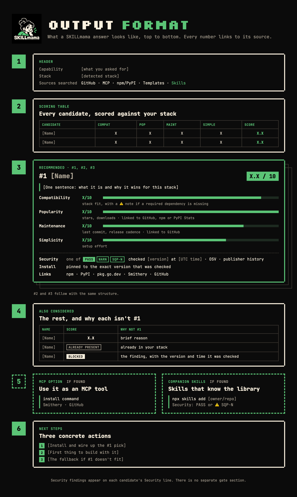

<p align="center"></p>

<p align="center">
  
  
  <a href="https://www.npmjs.com/package/skillmama"></a>
  <a href="https://skills.sh/Magithar/SKILLmama"></a>
</p>

<p align="center">
  SKILLmama eliminates the hours spent researching which library, SDK, or tool to use.<br/>
  It scans your project's actual stack, searches across 4 tiers of the ecosystem plus a companion-skills pass,<br/>
  and returns the top 3 ranked picks with scored evidence, install commands and links.<br/><br/>
  Works with <a href="#claude-code">Claude Code</a>, <a href="#claudeai-web--desktop">Claude.ai</a>, <a href="#openai-codex">OpenAI Codex</a>, and <a href="#antigravity">Antigravity</a>.
</p>

---

<p align="center">
  <a href="#see-it-in-action">Demo</a> • <a href="#build-in-public-series">Series</a> • <a href="#install">Install</a> • <a href="#usage">Usage</a> • <a href="#ai-adapters">AI Adapters</a> • <a href="#core-workflow">Core Workflow</a> • <a href="#ranking-formula">Ranking Formula</a> • <a href="#4-tier-search-hierarchy">4-Tier Search</a> • <a href="#output-format">Output Format</a> • <a href="#end-to-end-example">Example</a> • <a href="#project-structure">Project Structure</a> • <a href="#packages">Packages</a> • <a href="#evals">Evals</a> • <a href="#roadmap">Roadmap</a> • <a href="#stickers">Stickers</a>
</p>

---

## See it in action



---

## Build-in-public series

Ten posts on Dev.to about how SKILLmama was built.

| Part | Topic |
| ---- | ----- |
| [1](https://dev.to/magithar/stop-guessing-which-library-to-use-i-built-an-ai-capability-discovery-engine-3p7p) | Scoring formula, 5-tier search, end-to-end example |
| [2](https://dev.to/magithar/a-high-score-means-nothing-if-the-tool-is-dangerous-so-i-added-a-security-gate-3hpc) | Security gate, SQP rules, companion skills |
| [3](https://dev.to/magithar/i-got-tired-of-asking-what-am-i-missing-so-i-made-my-ai-ask-first-g8) | Project scanner, Flow B, gap analysis |
| [4](https://dev.to/magithar/a-reader-pointed-out-my-ask-first-principle-only-covered-half-my-tool-so-i-fixed-it-345c) | Phase 1.5, constraint confirmation in Flow A |
| [5](https://dev.to/magithar/the-bug-was-in-my-own-instructions-not-my-code-255p) | Tested my own install instructions, found they were wrong |
| [6](https://dev.to/magithar/i-watched-a-talk-called-dont-ship-skills-without-evals-then-checked-if-mine-had-any-1k0e) | Eval harness, trigger-classification tests, bugs found by testing instead of assuming |
| [7](https://dev.to/magithar/i-asked-the-same-question-with-and-without-my-own-skill-the-version-without-it-won-on-one-thing-5gjn) | Paired skill-on/skill-off ablation, the deployment persistence check it exposed, and the live CVE it later caught |
| [8](https://dev.to/magithar/a-reader-asked-what-my-security-check-actually-verifies-the-honest-answer-sent-me-back-to-the-1fif) | Building the live OSV.dev and npm publisher-continuity checks, and the real CVE that proved them |
| [9](https://dev.to/magithar/i-wrote-code-for-a-skill-thats-supposed-to-require-judgment-heres-where-i-drew-the-line-4j81) | The mechanical/judgment boundary, the conformance test, and the crates.io extension |
| [10](https://dev.to/magithar/building-verifiable-security-checks-source-linked-scores-and-honest-verdicts-in-skillmama-511c) | Version and timestamp on every verdict, source links on every score, PyPI downloads, and the skills.sh audit fix |

---

## Install

| Agent | How |
|-------|-----|
| Claude Code | `npx skills add Magithar/SKILLmama -a claude-code -g` |
| Claude.ai | Zip `skillmama/` and upload it under Customize → Skills ([steps](#claudeai-web--desktop)) |
| OpenAI Codex | Copy one file into `~/.codex/skills/` ([steps](#openai-codex)) |
| Antigravity | Copy one file into `~/.gemini/config/skills/` ([steps](#antigravity)) |

Codex and Antigravity need the manual copy because of an upstream CLI bug
([details](#why-codex-and-antigravity-need-a-manual-copy)).

### Claude Code

The upstream CLI works correctly for Claude Code:

```bash
npx skills add Magithar/SKILLmama -a claude-code -g
```

Installs to `~/.claude/skills/skillmama/`. Pass `-a claude-code` explicitly: without it the CLI
auto-detects the *calling* agent from the environment, so running it from inside another agent's
shell installs to that agent instead.

Then type `/skillmama` in any Claude Code session.

### Claude.ai (Web / Desktop)

1. Clone or download this repo
2. Zip the `skillmama/` folder:
   ```bash
   zip -r skillmama.zip skillmama/
   ```
3. Go to **Customize → Skills → +** and upload `skillmama.zip`
4. Type `/skillmama` in any Claude.ai conversation

### OpenAI Codex

Codex has a native global skills directory, `~/.codex/skills/`. The upstream CLI does **not**
write there ([why](#why-codex-and-antigravity-need-a-manual-copy)), so copy it yourself:

```bash
mkdir -p ~/.codex/skills/skillmama
curl -sL https://raw.githubusercontent.com/Magithar/SKILLmama/main/skillmama/SKILL.md \
  -o ~/.codex/skills/skillmama/SKILL.md
```

Then ask naturally: `codex "find me the best job queue for this project"`.

Codex was live-tested on 2026-09-27 with an explicit `/skillmama` invocation.
The run scanned this repository, asked for constraints, searched all four tiers
plus companion skills, produced scored results, and reported unavailable
security evidence as unverified rather than claiming a pass.

### Antigravity

Global skills live in `~/.gemini/config/skills/`, which is shared by all three Antigravity
surfaces (2.0, IDE, and the `agy` CLI) since Google consolidated their config. Confirmed by live
testing here and independently in
[#1470](https://github.com/vercel-labs/skills/issues/1470), including extraction
from the `agy` binary's own embedded docs.

1. Copy the file:

   ```bash
   mkdir -p ~/.gemini/config/skills/skillmama
   curl -sL https://raw.githubusercontent.com/Magithar/SKILLmama/main/skillmama/SKILL.md \
     -o ~/.gemini/config/skills/skillmama/SKILL.md
   ```

2. **Fully restart Antigravity** (skills load at startup), then ask **"Which skills are installed?"**
   to confirm. SKILLmama should appear in the list and in the `/` command picker.

3. **Invoke it explicitly.** Type `/` and select **SKILLmama** from the picker (or type `SKILLmama`
   before your request), then your capability question:

   ```
   SKILLmama find me the best vector database for a Python project
   ```

For a project-scoped install instead, put it in `<workspace>/.agents/skills/skillmama/SKILL.md`.

Explicit invocation was confirmed in live testing: it triggered the real pipeline, starting with a
Phase 1.5 constraint question rather than a generic answer. Plain prompts that don't name
`SKILLmama` were not confirmed to trigger the skill.

> Per [Antigravity's official Agent Skills docs](https://antigravity.google/docs/skills), the agent is also supposed to auto-trigger relevant skills from context alone, without explicit invocation — driven by the skill's `description:` frontmatter. We haven't verified that mode here (only explicit invocation was tested), so treat auto-trigger as unconfirmed and invoke explicitly for now.

> ⚠️ `npx skills add Magithar/SKILLmama -a antigravity -g` reports success but writes to
> `~/.agents/skills/`, which Antigravity never reads. Still reproduces on `skills@1.7.6`
> (2026-11-06). See [why](#why-codex-and-antigravity-need-a-manual-copy).

### Optional — install and verify in one command

[`skill-land`](https://github.com/Magithar/skill-land) ([npm](https://www.npmjs.com/package/skill-land))
installs to several agents in one command and **exits non-zero if the file didn't land**:

```bash
npx skill-land Magithar/SKILLmama --for claude-code,codex,antigravity
npx skill-land Magithar/SKILLmama --for codex --verify
```

Not required. The copy commands above work on their own.

### Why Codex and Antigravity need a manual copy

For **Codex** and **Antigravity**, `npx skills add ... -g` prints `Done!` and exits 0 while writing
to `~/.agents/skills/`, a directory neither agent reads. Re-verified on `skills@1.7.6`, the latest
release, on 2026-11-06.

The root cause is
[`isUniversalAgent()`](https://github.com/vercel-labs/skills/blob/main/src/installer.ts): agents
whose *project* dir is `.agents/skills` get misclassified, and their `globalSkillsDir` is discarded.
**13 agents are affected.**

Tracked in [#1060](https://github.com/vercel-labs/skills/issues/1060) and
[#1470](https://github.com/vercel-labs/skills/issues/1470). Two proposed fixes,
[PR #1483](https://github.com/vercel-labs/skills/pull/1483) and
[PR #2028](https://github.com/vercel-labs/skills/pull/2028), were closed without merging
(checked 2026-11-06).

Until a released CLI version fixes this, copy the file yourself using the per-agent instructions
above. Each one is two lines and lands in the directory that agent actually reads.

---

## Usage

```
/skillmama ← scans your project and asks what to find
/skillmama find me a vector database for my FastAPI project
/skillmama what auth library should I use for my Next.js app?
/skillmama find a .dwg parser for Node.js
```

Without an agent, the [`skillmama` CLI](#packages) runs the deterministic checks:

```bash
npx skillmama scan
npx skillmama check lodash --version 4.17.15
```

---

## AI Adapters

One file, [skillmama/SKILL.md](skillmama/SKILL.md), runs on every platform. Only the install
location differs.

| AI System    | Global skill directory              | `npx skills add -g` | `skill-land` |
| ------------ | ----------------------------------- | ------------------- | ----------------- |
| Claude Code  | `~/.claude/skills/skillmama/`       | ✅ correct           | ✅                 |
| OpenAI Codex | `~/.codex/skills/skillmama/`        | ❌ writes to `~/.agents/skills/` | ✅     |
| Antigravity  | `~/.gemini/config/skills/skillmama/`| ❌ writes to `~/.agents/skills/` | ✅     |
| Claude.ai    | n/a, upload only                    | n/a                 | n/a               |

Project-scoped installs go in `.claude/skills/` for Claude Code and `.agents/skills/` for Codex
and Antigravity.

Notes:

- The ❌ rows are the [upstream bug](#why-codex-and-antigravity-need-a-manual-copy), not a problem
  with this skill. Verified against `skills@1.5.22` on 2026-08-08; re-verified on `skills@1.7.6` on
  2026-11-06 — still unfixed.
- The `skills` CLI only discovers files named `SKILL.md`. Repos that ship per-platform variants
  under other names are invisible to it.
- Claude.ai is not CLI-installable. Zip the `skillmama/` folder and upload via Customize → Skills.

---

## Core Workflow

<p align="center"></p>

---

## Security & Quality Gate

Before scoring, every candidate passes through the gate (Phase 3.5). The first two layers query live data rather than relying on the model's recall:

| Layer | What it checks | Action |
| ----- | -------------- | ------ |
| Advisories | Live [OSV.dev](https://osv.dev) lookup for the exact version, across npm, PyPI, Go, and crates.io | 🚫 BLOCKED if CRITICAL/HIGH with no fix<br/>⚠️ WARN if a fix exists, or MODERATE/LOW |
| Publisher continuity | Whether npm or crates.io publish rights changed hands between releases | ⚠️ WARN, never an automatic discard |
| Hard Gate | Data exfiltration, no-disclosure destructive ops, jailbreak instructions | 🚫 BLOCKED or ⚠️ WARN (user confirms) |
| SQP-1 | Vague trigger phrases with no exclusion conditions | Flag in result |
| SQP-2 | Destructive/sensitive ops with no user-visible warning | Flag in result |
| SQP-3 | Hardcoded language/locale without user opt-in | Flag in result |

A few details behind those rows:

- **Advisories:** when OSV states the advisory's trigger condition (a specific mode, flag, or
  endpoint), it is quoted verbatim so you can judge whether your own usage is exposed. A WARN for
  a fixable advisory names the fixed version.
- **Publisher continuity** targets the
  [event-stream](https://blog.npmjs.org/post/180565383195/details-about-the-event-stream-incident)
  failure mode that advisory scanning misses. The warning names both publishers and the date.
  CI/trusted-publishing releases are not counted as a handoff.

### Known limits

Stated plainly, because a gate that oversells what it checks is worse than no gate:

- **Publisher continuity covers npm and crates.io.** Those are the two registries that expose a real per-release publisher identity. PyPI and Go don't, so candidates on those registries report `N/A (unsupported ecosystem)` rather than implying the check ran.
- **It catches handoffs, not account takeovers.** In the ua-parser-js, rc, and coa compromises the attacker published under the real maintainer's name, so this check reads clean. Only the advisory lookup catches those, and only after disclosure.
- **Only recent handoffs are reported** (under 12 months, most recent only). Measured across 98 popular npm packages: 51% carry a stale handoff somewhere in their history, so reporting all of them would fire on more than half of npm and train you to ignore the warning. With the recency filter, 7%.
- **Advisory lookup covers the direct package,** not the full transitive dependency tree.
- **Unreachable service means `N/A (unverified)`,** never a silent pass.

### Deeper static analysis

SQP rules are inspired by [NVIDIA/SkillSpector](https://github.com/NVIDIA/SkillSpector) (Apache 2.0). For deeper static analysis with 64 vulnerability patterns, run SkillSpector directly:

```bash
uv tool install git+https://github.com/NVIDIA/skillspector.git
skillspector scan <repo-url>
```

> Earlier versions of this README said `pip install skillspector`. That package does not exist on
> PyPI (404); SkillSpector installs from git via `uv`. Corrected 2026-08-08.

[`skill-land`](https://github.com/Magithar/skill-land) runs this scan
before writing a skill to disk and reports the findings. It does **not** block on them: measured
against 18 known-good installed skills, SkillSpector's static mode returns `DO_NOT_INSTALL` for
44% of them. Pass `--strict` if you want it to refuse.

### How SKILLmama itself scores

This skill scores `7 / LOW / SAFE`. It previously scored `100 / CRITICAL / DO_NOT_INSTALL`, because
its own Phase 3.7 DISCARD criteria contained phrases like *"instructions to bypass safety checks"*
and the static matcher read the checklist as the attack. Four criteria were reworded to say the
same thing in different words. No rule was weakened, and adding a user-consent section was tested
and made the score **worse**, not better: describing a safeguard trips the same patterns as
describing the danger.

---

## Ranking Formula

Every candidate that passes the gate is scored 1–10 on four dimensions:

| Factor        | Weight | Signals                                                  |
| ------------- | ------ | -------------------------------------------------------- |
| Compatibility | 40%    | Language/framework fit, official SDK, integration effort |
| Popularity    | 30%    | GitHub stars, npm/PyPI/go weekly downloads               |
| Maintenance   | 15%    | Days since last commit, release cadence                  |
| Simplicity    | 15%    | Setup effort, documentation quality                      |

`Total = (Compat × 0.40) + (Pop × 0.30) + (Maint × 0.15) + (Simp × 0.15)`

---

## 4-Tier Search Hierarchy

<p align="center"></p>

Sources linked from the diagram: [Smithery](https://smithery.ai) for MCP servers, and [skills.sh](https://skills.sh), [TerminalSkills.io](https://terminalskills.io) and [SkillsMP](https://skillsmp.com) for companion skills.

---

## Output Format

<p align="center"></p>

Security findings from the internal gate surface inline on each candidate's `Security:` line — there is no separate gate section in the output.

Every Popularity, Maintenance, and Security value links to the page it was read from, so you can check any number yourself. A value that can't be linked is reported as `N/A (unverified)`, with whether the source was unavailable or the check wasn't run.

---

## End-to-End Example

A live run from 2026-11-18 against a small sample project: FastAPI, SQLAlchemy and psycopg in
`pyproject.toml`, a Postgres 16 service in `docker-compose.yml`, and `OPENAI_API_KEY` in
`.env.example`. Every number below was read from the linked page during the run, so expect them to
have drifted by the time you read this.

**User prompt:**

```
find me a vector database for my FastAPI + Python project
```

**Step 1 — Architecture Scan**

```
✓ pyproject.toml      → Python 3.11, FastAPI, SQLAlchemy, psycopg, openai
✓ docker-compose.yml  → api + postgres:16 (volume pgdata), Dockerfile build
✓ .env.example        → DATABASE_URL (Postgres), OPENAI_API_KEY → RAG use case
```

Detected stack: `Python / FastAPI / PostgreSQL / Docker / OpenAI`

**Step 2 — Confirm Constraints** (Phase 1.5 — no constraints were stated, so SKILLmama asks one informed question and stops)

```
SKILLmama: I see you're on Python / FastAPI / PostgreSQL / Docker / OpenAI.
Before I search — any constraints? (e.g. self-hosted, open-source only,
free tier, must integrate with PostgreSQL). Reply "none" to search with no filters.

User: containerizable, Python client, must stay open-source
```

**Step 3 — Capability Detection**

```
CAPABILITY : vector database for RAG / semantic search
STACK      : Python / FastAPI / PostgreSQL / Docker / OpenAI
CONSTRAINTS: containerizable, Python client, open-source
```

**Step 4 — 4-Tier Search**

```
Tier 1 GitHub    → milvus-io/milvus (46.7k★), qdrant/qdrant (35.6k★), chroma-core/chroma (29.7k★),
                   pgvector/pgvector (23.7k★), weaviate/weaviate (17.0k★)
Tier 2 MCP       → qdrant/mcp-server-qdrant (official), vector-mcp (multi-backend)
Tier 3 PyPI      → pgvector (10.9M/wk), qdrant-client (3.6M/wk), chromadb (2.0M/wk),
                   weaviate-client (1.3M/wk), pymilvus (740k/wk)   [pypistats.org, last week]
Tier 4 Templates → danny-avila/rag_api (FastAPI + pgvector), vstorm-co/full-stack-ai-agent-template
Skills (3.6)     → qdrant/skills, timescale/pg-aiguide (pgvector-semantic-search), zilliztech/milvus-skill
```

**Step 5 — Output**

Qdrant ranks #1 (9.45), Weaviate #2 (8.75) and pgvector #3 (7.95). Chroma is blocked on a
CRITICAL advisory with no fixed version.

<details>
<summary><b>Show the full output</b></summary>

```
## SKILLmama Results

Capability: vector database for RAG
Stack: Python / FastAPI / PostgreSQL / Docker / OpenAI
Sources searched: Tier 1 (GitHub) · Tier 2 (MCP) · Tier 3 (PyPI) · Tier 4 (Templates) · Skills (skills.sh + TerminalSkills.io + SkillsMP + GitHub SKILL.md)

---

**Scoring all candidates against Python / FastAPI / PostgreSQL / Docker / OpenAI:**

| Candidate | Compat | Pop | Maint | Simple | Score    |
|-----------|--------|-----|-------|--------|----------|
| Qdrant    | 9      | 10  | 10    | 9      | **9.45** |
| Weaviate  | 8      | 10  | 10    | 7      | **8.75** |
| pgvector  | 6      | 10  | 9     | 8      | **7.95** |
| Milvus    | 7      | 10  | 10    | 4      | **7.90** |

---

#1 — Qdrant · Score: 9.45/10
Official Python client, one container next to your existing compose services, official MCP server.
- Compatibility: 9/10  — official qdrant-client SDK with an async client; no API key or extra env var needed locally
- Popularity:   10/10  — 35.6k GitHub stars, 3.6M PyPI downloads/week ([GitHub](https://github.com/qdrant/qdrant) · [PyPI Stats](https://pypistats.org/packages/qdrant-client))
- Maintenance:  10/10  — pushed 2026-11-18, v1.20.2 released 2026-11-16 ([GitHub](https://github.com/qdrant/qdrant/releases))
- Simplicity:    9/10  — one `docker run` (ports 6333/6334) plus pip install ([quickstart](https://qdrant.tech/documentation/quickstart/))
- Security:     PASS  — no OSV advisories · checked qdrant-client 1.20.0, 2026-11-18 19:32 UTC · [OSV](https://osv.dev/list?ecosystem=PyPI&q=qdrant-client) · publisher history N/A (unsupported ecosystem: PyPI)
- Install: pip install qdrant-client==1.20.0 (server image: qdrant/qdrant:v1.20.2)
- Links: [PyPI](https://pypi.org/project/qdrant-client/) · [GitHub](https://github.com/qdrant/qdrant) · [MCP server](https://github.com/qdrant/mcp-server-qdrant)

#2 — Weaviate · Score: 8.75/10
Single-container server with built-in hybrid search; a little more setup than Qdrant.
- Compatibility: 8/10  — official weaviate-client v4; it talks gRPC as well as HTTP, so the container needs both ports exposed
- Popularity:   10/10  — 17.0k GitHub stars, 1.3M PyPI downloads/week ([GitHub](https://github.com/weaviate/weaviate) · [PyPI Stats](https://pypistats.org/packages/weaviate-client))
- Maintenance:  10/10  — pushed 2026-11-18, v1.40.5 released 2026-11-10 ([GitHub](https://github.com/weaviate/weaviate/releases))
- Simplicity:    7/10  — one container; auto-schema works for a first try, but Weaviate recommends defining collections yourself for production ([Docker guide](https://docs.weaviate.io/deploy/installation-guides/docker-installation) · [collections](https://docs.weaviate.io/weaviate/config-refs/collections))
- Security:     PASS  — no OSV advisories · checked weaviate-client 4.24.1, 2026-11-18 19:32 UTC · [OSV](https://osv.dev/list?ecosystem=PyPI&q=weaviate-client) · publisher history N/A (unsupported ecosystem: PyPI)
- Install: pip install weaviate-client==4.24.1
- Links: [PyPI](https://pypi.org/project/weaviate-client/) · [GitHub](https://github.com/weaviate/weaviate)

#3 — pgvector · Score: 7.95/10
Stay on the Postgres you already run, with SQLAlchemy support in the Python package.
- Compatibility: 6/10  — ⚠️ requires the pgvector extension, which the `postgres:16` image in docker-compose.yml doesn't include. SKILL.md caps a verified missing dependency at the 4–6 band. The fix is small: switch to `pgvector/pgvector:pg16` and run `CREATE EXTENSION vector`. With that done, Compatibility is 9 and the total is 9.15, which puts pgvector at #2
- Popularity:   10/10  — 23.7k GitHub stars, 10.9M PyPI downloads/week ([GitHub](https://github.com/pgvector/pgvector) · [PyPI Stats](https://pypistats.org/packages/pgvector))
- Maintenance:   9/10  — pushed 2026-11-18, but the last tag (v0.8.7) is from 2026-10-01, 48 days earlier. SKILL.md's 10 band also asks for active releases, which a 48-day-old tag doesn't show ([GitHub](https://github.com/pgvector/pgvector/tags))
- Simplicity:    8/10  — one image swap and one SQL statement, no new service ([Docker image](https://github.com/pgvector/pgvector#docker))
- Security:     PASS  — no OSV advisories · checked pgvector 0.5.1, 2026-11-18 19:32 UTC · [OSV](https://osv.dev/list?ecosystem=PyPI&q=pgvector) · publisher history N/A (unsupported ecosystem: PyPI)
- Install: pip install pgvector==0.5.1 (database image: pgvector/pgvector:pg16)
- Links: [PyPI](https://pypi.org/project/pgvector/) · [GitHub](https://github.com/pgvector/pgvector-python)

Tiebreaker: pgvector (7.95) and Milvus (7.90) are within 0.5. pgvector takes #3 because it reuses
the Postgres service you already run, while Milvus standalone adds etcd and MinIO.

---

Also Considered:
| Name   | Score   | Why not #1 | Links |
|--------|---------|------------|-------|
| Milvus | 7.90    | Standalone runs etcd and MinIO alongside Milvus ([compose file](https://github.com/milvus-io/milvus/releases/download/v3.0.6/milvus-standalone-docker-compose.yaml)), heavy for one FastAPI service | [PyPI](https://pypi.org/project/pymilvus/) · [gh](https://github.com/milvus-io/milvus) |
| Chroma | BLOCKED | CRITICAL GHSA-f4j7-r4q5-qw2c: pre-auth code injection, "by sending a malicious model repository and trust_remote_code set to true" to the collections endpoint; plus 1 more CRITICAL and 2 HIGH, none with a fixed version · checked chromadb 1.5.9, 2026-11-18 19:29 UTC | [gh](https://github.com/chroma-core/chroma) · [advisory](https://osv.dev/vulnerability/GHSA-f4j7-r4q5-qw2c) |

---

MCP Option: qdrant/mcp-server-qdrant, the official MCP server for semantic memory over Qdrant.
[GitHub](https://github.com/qdrant/mcp-server-qdrant)

---

Companion Skills:
> qdrant/skills: official Qdrant skills (client SDKs, deployment, multitenancy, performance)
> npx skills add qdrant/skills
> [skills.sh](https://skills.sh/qdrant/skills) · [GitHub](https://github.com/qdrant/skills)
> Security: ⚠️ SQP-2 — qdrant-clients-sdk tells the agent to curl skills.qdrant.tech for code snippets without telling the user

> timescale/pg-aiguide: pgvector-semantic-search (HNSW/IVFFlat, halfvec, filtered search)
> npx skills add timescale/pg-aiguide --skill pgvector-semantic-search
> [skills.sh](https://skills.sh/timescale/pg-aiguide/pgvector-semantic-search) · [GitHub](https://github.com/timescale/pg-aiguide)
> Security: PASS

Next Steps:
1. Add a qdrant/qdrant:v1.20.2 service with a volume to docker-compose.yml and pip install qdrant-client==1.20.0
2. Embed your documents with OpenAI, store them in Qdrant, and retrieve the top matches before each model call
3. If you'd rather not add a service, swap postgres:16 for pgvector/pgvector:pg16 and try pgvector first
```

</details>

---

## What SKILLmama Is Not

- Not an IDE or autocomplete assistant
- Not a chatbot
- Not a package manager

SKILLmama is a **capability oracle**: it tells you what to use and why, with evidence.

---

## Project Structure

```
SKILLmama/
├── skillmama/
│   └── SKILL.md               # the skill — one file, runs on every platform
├── .claude/
│   └── skills/skillmama/
│       └── SKILL.md           # symlink → ../../../skillmama/SKILL.md
├── .claude-plugin/
│   └── plugin.json            # makes the repo installable as a Claude Code plugin
├── commands/
│   └── stickers.md            # plugin slash command: /skillmama:stickers
├── packages/
│   ├── core/                  # deterministic slices of the pipeline, as tested code
├── scripts/
│   └── check-skill-untouched.sh  # guard: SKILL.md and its install copy stay in sync
├── evals/
│   ├── skillmama-ablation.md  # manual trigger/pipeline eval + result log
│   └── skill-on-vs-skill-off-comparison.md  # raw ablation transcript
├── ROADMAP.md                 # what is implemented and what is left
├── CHANGELOG.md
└── README.md
```

**One source of truth.** Until v1.4.7 this repo carried four hand-maintained copies
(`codex/AGENTS.md`, `antigravity/PROMPT.md`, `.claude/commands/skillmama.md`) which had
[quietly drifted apart](CHANGELOG.md) more than once. Every platform reads a plain `SKILL.md`,
so the copies were removed and the Claude Code entry is a symlink. Drift is now impossible
rather than merely discouraged.

> Note for Windows contributors: git needs `core.symlinks=true` (and Developer Mode) to check
> out `.claude/skills/skillmama/SKILL.md` as a real symlink. Without it you'll get a text file
> containing the target path. It only affects the repo-local slash command, not installs.

---

## Packages

SKILLmama is a capability discovery system. `SKILL.md` is the agent-native
implementation and the specification. The `skillmama` npm package provides a
CLI and a programmatic runtime for the deterministic parts of that system. The
shared deterministic rules are checked against SKILL.md by conformance tests.

`packages/` is a separate, additive layer: it extracts the slices of the pipeline
that are *genuinely* deterministic into code that can be unit-tested, and refuses
to fake the rest.

| Package | Name | State |
| --- | --- | --- |
| [`packages/core`](packages/core) | [`skillmama`](https://www.npmjs.com/package/skillmama) | published, `0.6.0` |

```bash
npm ci
npm test
npx skillmama scan .           # structured project scan
npx skillmama check lodash --version 4.17.15   # live OSV + factor checks
```

### One package, one public surface

There is one package. `packages/core` is a folder name, not a second identity:
it carries the `skillmama` bin and the programmatic API in a single publishable
unit, so nothing has to explain a `core`/`cli` split to a user who just wants
the command. `src/cli/` holds the binary, and `package.json`'s `exports` maps
`.` only — the detector and parser registries, the query builders, the hit
normalizers, and the HTTP payload normalizers stay internal and cannot be
deep-imported. The supported surface is exactly what `src/index.ts` names, and
`test/index.test.js` fails if that list drifts in either direction.

### What the CLI does

The CLI is the package's real consumer: `scan` runs `analyzeProject()`, and
`check` runs the live-data half of the pipeline — OSV advisories, npm publisher
continuity, and the Popularity/Maintenance band lookups — against a published
package. It has no LLM, so it cannot produce Phase 3.5's content findings, and
it says so above the verdict rather than letting a PASS read as "safe".

### Implemented in core

<details>
<summary><b>Show what each function does</b></summary>

- **`analyzeProject()`** — structured project scan. Parses seven dependency manifests
  and five deployment configs from a directory's top level. Sorted, deduplicated,
  fixture-pinned output.
- **`scoreCandidate()`** — the 40/30/15/15 arithmetic, with `"N/A"` factors excluded
  and the surviving weights renormalized rather than silently deflating the total.
- **`gatherSecurityEvidence()`** — Phase 3.5 Stage 1: the OSV.dev advisory query and
  the npm publisher-continuity check. Evidence only; no verdict.
- **`resolveSecurityVerdict()` / `verifyCandidate()`** — Phase 3.5 Stage 2's decision
  table: OSV CRITICAL/HIGH with no fix blocks, with a fix warns, MODERATE/LOW warn,
  a recent publisher handoff warns, an unreachable check floors the verdict at WARN
  ("never read as passed") while an unsupported ecosystem is reported without changing it, DISCARD-weight findings block outright over WARN/FLAG,
  and FLAG rules surface independently as `sqpFlags`.
- **`gatherFactorEvidence()` / `mapPopularityBand()` / `mapMaintenanceBand()`** —
  Phase 4's two live-data factors, split like Phase 3.5: one GitHub request for
  stars and last-push date plus one request for weekly downloads (npm, or
  pypistats.org for PyPI), then
  SKILL.md's band tables as a lookup. Unverified sources stay unverified rather
  than becoming a low score, and one thing gets reported instead of guessed:
  the Maintenance 10 band also requires "active releases", which a push date
  cannot establish. Picking a point inside a band stays judgment.
- **`normalizeSearchHits()`** — Phase 3 Stage C: TierResult[] → deduplicated
  `Candidate[]` with tier provenance. Names are extracted structurally from
  GitHub/npm/PyPI URL shapes (title as fallback), duplicates resolve to the
  earlier tier deterministically.
- **`discoverCapabilities()`** — Phases 2-5 composed. Owns the sequencing rules
  SKILL.md states as prohibitions: ALREADY PRESENT candidates are dropped before
  scoring, BLOCKED ones never rank (but are still returned), the required
  companion search cannot be skipped by accident, and ranking is total and
  reproducible. Its strongest guarantee is that an injected judge may pick a
  point *inside* a verified band and nothing else — Popularity 10 on evidence
  that says 7-9 throws rather than scores.
- **`findCandidates()` / `findCompanionSkills()`** — the two tool-backed phases,
  fully orchestrated: SKILL.md's tier recipes and the four fixed companion
  searches are mechanically filled templates, every tier/source is structurally
  guaranteed to run in canonical order, normalization goes through the tested
  pure path, and the Phase 3.7 gate applies its decision table (rating and
  DISCARD auto-block, WARN/FLAG surface as notes/`sqpFlags`). What stays
  injected, never faked: choosing search terms (Stage A), executing searches
  and judging hits (Stage B), and reading a skill's content for the 3.7 gate.

</details>

### Guards

Two guards keep `packages/` honest about SKILL.md:

- `scripts/check-skill-untouched.sh` asserts `skillmama/SKILL.md` is unchanged and
  byte-identical to its `.claude/skills/` install copy. Copy drift caused two past
  bugs, so the invariant is checked mechanically instead of in review.
- `packages/core/test/skill-conformance.test.js` parses SKILL.md at test time and
  asserts the code agrees with what it says — the weights, both band tables, the
  literal bot-publisher list, the tier headings and query recipes, and the four
  fixed companion searches. Mutation-tested against ten separate SKILL.md edits.
  SKILL.md stays the source of truth; a failure means the code needs updating.

---

## Evals

SKILLmama ships a manual eval harness at [`evals/skillmama-ablation.md`](evals/skillmama-ablation.md):
5 prompts that should trigger the skill, 5 that shouldn't, run skill-on vs. skill-off. It's checked
after any change to the Trigger rules or the core phases.

The log has already caught and fixed three real bugs:

- A silent empty scan when the working directory didn't match the stated stack.
- Maintenance scores presented as verified when they were actually estimated.
- A deployment-persistence blind spot: recommending an in-process store without checking whether
  the hosting platform's disk survives a restart. This one was found by a real paired
  skill-off/skill-on ablation run, not just inference.

See [`evals/skill-on-vs-skill-off-comparison.md`](evals/skill-on-vs-skill-off-comparison.md) for the full unedited transcript of that ablation run: the same question asked with and without SKILLmama, side by side.

Inspired by [Philipp Schmid](https://github.com/philschmid)'s (Google DeepMind) talk "Don't Ship Skills Without Evals," and the paired skill-on/skill-off ablation methodology from [SkillsBench](https://arxiv.org/abs/2602.12670) (Li et al.), also live at [skillsbench.ai](https://www.skillsbench.ai/).

---

## Roadmap

[`ROADMAP.md`](ROADMAP.md) tracks what is left, in priority order. `skillmama` is
published to npm, and Codex and Antigravity have both been live-tested. The
Compatibility and Simplicity factors stay outside the package deliberately — their bands are written in terms
only a reader of the docs can assess.

---

## Stickers

Click a sticker to open it, then download the image to print it, use it as a custom emoji, or add it to a post. From a terminal, `npx skillmama stickers` opens this section. With the Claude Code plugin installed, so does `/skillmama:stickers`.

| [](assets/stickers/skillmama-logo.png) | [](assets/stickers/thumbs-up.png) | [](assets/stickers/celebrate.png) | [](assets/stickers/coffee.png) | [](assets/stickers/sleepy-cat.png) |
|:--:|:--:|:--:|:--:|:--:|
| Logo | Thumbs-up | Celebrate | Coffee | Sleepy cat |

Free to print and share, just don't sell them. The stickers are separate from the code's Apache 2.0 license.

---

## Related

- [skill-land](https://github.com/Magithar/skill-land): install a skill to the directory the agent
  actually reads, then prove it landed. Works for SKILLmama on Codex and Antigravity, where
  `npx skills add -g` writes somewhere they never look.
- [Magithar/skills](https://github.com/Magithar/skills): more agent skills, in a Claude Code
  marketplace that also lists SKILLmama.

---

## Contributing

See [CONTRIBUTING.md](CONTRIBUTING.md) for setup and validation guidance.
Security reports should follow [SECURITY.md](SECURITY.md).
